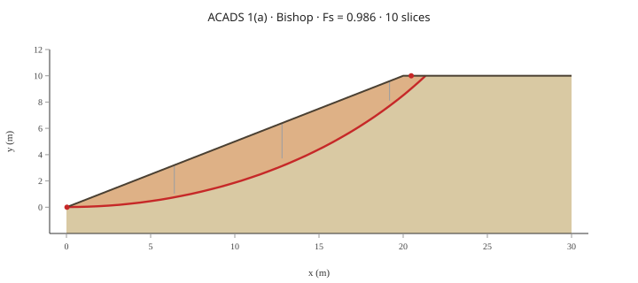

# slopestab

**2D slope stability analysis · five limit-equilibrium methods · numpy only · every number auditable**

[](https://github.com/lizhengyang-byte/slopestab/actions/workflows/ci.yml)
[](pyproject.toml)
[](LICENSE)

[中文](README.md) · **English**

> Status: v0.1.0 (source available, **not published on PyPI yet**). See _Install_ below.

`slopestab` implements five classical limit-equilibrium methods (Fellenius / Bishop /
Janbu / Spencer / Morgenstern-Price) on a single geometry and slicing kernel, with
circular slip-surface search, pore pressure and pseudo-static seismic loading,
infinite-slope and planar-wedge closed forms, section plots and self-contained HTML
calculation reports.

The only runtime requirement is `numpy`: it still computes without matplotlib, and
results can always be exported to CSV / JSON.

---

## Why another tool

| Existing option | Pain point | What slopestab does |
|---|---|---|
| `pyslope` | circular surfaces only, essentially Bishop | five LEMs on one slice set, cross-checkable |
| Commercial codes (Slide / GeoStudio) | not scriptable, hard to reproduce, no CI | pure Python, deterministic, benchmarks in CI |
| Loose scripts from papers | not a library, untested, arbitrary slice cuts | forced cuts at layer/water boundaries + equilibrium audit |

The goal is narrow and explicit: **cover the standard methods, get the numbers right,
and be able to defend them**. It is not trying to be a finite-element package.

---

## Install

Not on PyPI yet; install from source:

```bash
git clone https://github.com/lizhengyang-byte/slopestab
cd slopestab
pip install -e .             # core only (numpy)
pip install -e ".[all]"     # + matplotlib (plots/reports) + PyYAML (yaml cases)
```

Python ≥ 3.9 required; the CI matrix covers 3.9 / 3.11 / 3.13.

---

## 30-second start

```python
import slopestab as sst

slope = sst.Slope([(0, 0), (20, 10), (30, 10)])          # ground profile, metres
soil = sst.SoilModel([sst.SoilLayer("clay", c=3.0, phi=19.6, gamma=20.0)])
circle = sst.SlipCircle(cx=0.03, cy=27.70, r=27.69)      # ACADS 1(a) standard circle

for method in ["fellenius", "bishop", "janbu", "spencer", "morgenstern_price"]:
    res = sst.analyze(method, slope, soil, circle, n_slices=30)
    print(f"{method:20s} Fs = {res.fs:.4f}")

best = sst.search_circular(slope, soil, method="bishop")  # critical surface search
print(best.fs, best.critical.surface)
```

Actual output (30 slices; published values are compared in _Verification_):

```
fellenius             Fs = 0.9479
bishop                Fs = 0.9854
janbu                 Fs = 0.9427   (uncorrected)
spencer               Fs = 0.9844
morgenstern_price     Fs = 0.9841
```



---

## Methods

| Method | Equilibrium | Interslice assumption | Notes |
|---|---|---|---|
| `fellenius` (ordinary) | moment | ignored | conservative lower bound, typically 5–15 % low |
| `bishop` (simplified) | moment | horizontal | the workhorse; usually within 1–2 % of Spencer |
| `janbu` (simplified) | horizontal force | zero shear | needs `f0`: `analyze(..., f0=1.05)` |
| `spencer` | moment + force | parallel, $X/E=\tan\theta$ | rigorous, solves $(\mathrm{Fs},\theta)$ simultaneously |
| `morgenstern_price` | moment + force | $X=\lambda f(x)E$ | most general; $f(x)$ = constant / half_sine / sine / trapezoid |

Two special cases have closed-form implementations of their own:

- `infinite_slope_fs()`: infinite slope (dry, or steady seepage parallel to the face),
  with `critical_depth()` inverting $\mathrm{Fs}=1$;
- `planar_wedge()`: plane failure wedge with a tension crack, water in the crack and
  pseudo-static seismic loading.

---

## Verification

"Runs without errors" is not verification. Four independent layers of evidence, all
reproducible with the commands below.

**1. External benchmark — ACADS 1(a)** (Giam & Donald 1989; 10 m, 2H:1V, homogeneous,
$c'=3$ kPa, $\varphi'=19.6^\circ$, $\gamma=20$ kN/m³, prescribed circle centre
(0.03, 27.70), $R=27.69$ m):

| Method | slopestab | Published | Deviation |
|---|---|---|---|
| Bishop simplified | 0.9854 | 0.987 (Slide2) / 0.992 (Zhao 2014) | −0.002 / −0.007 |
| Spencer | 0.9844 | 0.986 (Slide2) | −0.002 |
| Morgenstern-Price | 0.9841 | 0.986 (Slide2 GLE) / 0.991 (Zhao) | −0.002 / −0.007 |
| Janbu with $f_0=1.05$ | 0.9987 | 1.000 (ACADS answer) | −0.001 |
| Fellenius | 0.9479 | — | conservative bound, as expected |

**2. Agreement with an independent implementation.** One test recomputes Bishop without
reusing any package code — its own circle/ground intersections, its own equal-width
trapezoid slices, its own $m_\alpha$ fixed-point loop. It returns **0.9854**, matching
the library. That rules out "internally consistent but wrong".

**3. Exact identities:**

- with $\varphi=0$, Bishop must equal Fellenius and equal the analytic moment solution
  $cLR/\sum W(x-x_0)$ — measured 2.43710 / 2.43732 / 2.43732, gap $2.2\times10^{-4}$;
- M-P with $f(x)\equiv1$ must equal Spencer — both 1.4944 with $\lambda=0.391$;
- infinite slope matches hand calculation; wedge geometry and weight match hand
  calculation ($A=50$ m², $W=900$ kN/m, $\mathrm{Fs}=3.399$).

**4. Self-consistency:** Bishop changes by less than 0.001 from 10 to 80 slices;
rigorous $F_x$ and $M$ residuals sit at zero; slice weights reproduce the polygon area
to 0.05 %.

Full tables, deviation attribution and reproduction commands:
[`docs/validation.md`](docs/validation.md).

---

## Documentation

| Document | Content |
|---|---|
| [`docs/methods.md`](docs/methods.md) | sign conventions, forced cuts, equations and derivations, numerics |
| [`docs/validation.md`](docs/validation.md) | benchmarks, convergence, identities, residual tables, deviation attribution |
| [`docs/api.md`](docs/api.md) | every public interface, argument, return value and exception |
| [`CONTRIBUTING.md`](CONTRIBUTING.md) | development, local checks, rules for changing numbers |

Both documents above are written in Chinese; this file is the English mirror of `README.md`.

---

## What a result contains

`analyze()` returns a `LEMResult`, not a bare number:

```python
res.fs                       # factor of safety
res.slices.to_dataframe()    # slice table (pandas optional)
res.residuals                # {'Fx':…, 'Fy':…, 'M':…, 'Fx_abs':…, …}
res.info                     # lambda, theta, iterations, notes when relevant
res.to_csv("slices.csv"); res.to_json("result.json")
sst.report_html(res, "report.html")     # self-contained report, opens offline
```

**Every result carries its equilibrium imbalance.** Bishop / Fellenius only satisfy
moment equilibrium, so a non-zero force residual is expected by definition — but it is
reported, not hidden.

---

## Command line

```bash
slopestab run    examples/cases/01_simple_slope.yaml  --method bishop  --plot out.png --report r.html
slopestab search examples/cases/02_layered_water.yaml --method spencer --csv all_circles.csv
slopestab methods
```

Case files are YAML or JSON:

```yaml
method: bishop
n_slices: 30
slope:
  profile: [[0, 0], [10, 0], [30, 10], [50, 10]]
soil:
  layers:
    - {name: fill, c: 5, phi: 25, gamma: 18, gamma_sat: 19.5, boundary: [[0, 3], [50, 3]]}
    - {name: clay, c: 15, phi: 18, gamma: 19, gamma_sat: 20}
surface: {type: circle, cx: 10.03, cy: 27.70, r: 27.69}
water: {type: phreatic, points: [[10, 0], [30, 9], [50, 9]]}
seismic: {kh: 0.1, kv: 0.0}
surcharge: [{q: 20, x_start: 25, x_end: 50}]
```

---

## Conventions (easy to get wrong)

- **SI units throughout**: metres, kPa, kN/m³, angles in **degrees**.
- **Sliding direction is inferred**: from the elevations of the two surface intersections;
  `sin α > 0` always means "descending along the sliding direction", so the driving force
  is always the positive contribution $\sum W\sin\alpha$.
- **Forced slice cuts**: slope vertices, layer boundaries, water-table crossings and
  surcharge edges are all inserted as slice boundaries, so each base sits inside one
  layer and one pore-pressure rule. This is where most ad-hoc scripts lose accuracy.
- **Piecewise unit weights**: $\gamma$ above and $\gamma_{\mathrm{sat}}$ below the water
  table, integrated segment by segment — never averaged over a whole slice.
- **Invalid input raises instead of being silently repaired**: non-admissible geometry,
  pore pressure exceeding slice weight, non-convergence — all raise, with a reason.
- **Reproducible**: deterministic grid plus deterministic polishing; same input, same output.

---

## Intentional failures

| Input | Behaviour |
|---|---|
| fewer than two surface/ground intersections | `ValueError`: must cross the ground surface at least twice |
| fewer than 5 slices | `ValueError`: n_slices should be at least 5 |
| water table above the ground surface (pore pressure > slice weight) | `ValueError`, quoting the offending x, `u*b` and `W` |
| non-circular surface with Spencer / M-P | `GeometryError` (unsupported in v0.1, see limitations) |
| non-circular surface with Bishop / Janbu | computed normally (moment centre = polyline mean point) |
| iteration reaching a non-physical Fs (≤ 0) | `ConvergenceError`, carrying `last_fs` |
| net driving force ≤ 0 (not a mechanism) | `ArithmeticError` |

---

## Known limitations

- **Rigorous methods support circular surfaces only.** Non-circular Spencer / M-P need
  extra assumptions about the moment centre and the interslice force line; v0.1 refuses
  rather than printing a plausible-looking number (Bishop and Spencer can differ by 34 %
  on a non-circular surface).
- **Janbu's `f0` is not looked up automatically.** The default 1.0 is the uncorrected
  value and is systematically low; use Spencer / M-P for design, or supply `f0` yourself.
- **The phreatic line is hydrostatic** ($u=\gamma_w h$); no seepage solve. For transient
  flow, compute pore pressures elsewhere and feed them in.
- **Out of scope**: FEM strength reduction (SRM), 3D wedges, dynamic time history, GIS import.
- Slice bases are chords, so results typically differ from commercial codes by 1–2 %
  (area attribution in `docs/validation.md` §1.1).

---

## Roadmap

- v0.2: rigorous GLE on non-circular surfaces, reinforcement (soil nails / anchors / geogrid),
  true arc-length base integration
- v0.3: reliability (Monte Carlo / FOSM), automatic Janbu `f0`
- longer term: QGIS / GeoPandas section import, report templating

---

## Contributing / citation / licence

- If a case does not check out, open an issue with a `case.yaml` — worth more than a star.
- Process in [`CONTRIBUTING.md`](CONTRIBUTING.md); any change to numbers must update
  benchmarks and documentation together.
- Citation metadata in [`CITATION.cff`](CITATION.cff); history in [`CHANGELOG.md`](CHANGELOG.md).
- MIT licence. **Results must be reviewed by a licensed geotechnical engineer before use
  in design.**

Author: Li Shangru (Chengdu Jincheng College) · 2026
