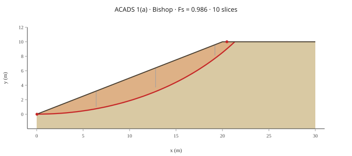

# slopestab

**二维边坡稳定性分析 · 五种极限平衡法 · 只依赖 numpy · 每个数都可复核**

[](https://github.com/lizhengyang-byte/slopestab/actions/workflows/ci.yml)
[](pyproject.toml)
[](LICENSE)

**中文** · [English](README.en.md)

> 当前状态：v0.1.0（源码可用，**尚未发布到 PyPI**）。安装方式见下文「安装」。

`slopestab` 用同一套几何与条分内核实现五种经典极限平衡法（Fellenius / Bishop /
Janbu / Spencer / Morgenstern-Price），带圆弧滑面自动搜索、孔压与拟静力地震、
平面楔体与无限边坡闭式解、剖面出图与自包含 HTML 计算书。

核心运行依赖只有 `numpy`：没装 matplotlib 也能算，算完仍可导出 CSV / JSON。

---

## 为什么再造一个轮子

| 现有选择 | 痛点 | slopestab 的取舍 |
|---|---|---|
| `pyslope` | 只有圆弧滑面、方法单一 | 五种 LEM 共用一套切片，可横向互校 |
| 商业软件（Slide / GeoStudio） | 不可编程、结果难复现、无法进 CI | 纯 Python、确定性、基准题进 CI |
| 论文里的零散脚本 | 不成库、无测试、切点随意 | 层界/水线强制加密 + 平衡残差审计 |

目标很明确：**方法齐、算得准、结果能交代**。不追求做成有限元软件。

---

## 安装

尚未发布到 PyPI，请从源码安装：

```bash
git clone https://github.com/lizhengyang-byte/slopestab
cd slopestab
pip install -e .             # 核心（只装 numpy）
pip install -e ".[all]"     # + matplotlib（出图/计算书）+ PyYAML（yaml 算例）
```

要求 Python ≥ 3.9；CI 矩阵覆盖 3.9 / 3.11 / 3.13。

---

## 30 秒上手

```python
import slopestab as sst

slope = sst.Slope([(0, 0), (20, 10), (30, 10)])          # 坡面折线，单位 m
soil = sst.SoilModel([sst.SoilLayer("黏土", c=3.0, phi=19.6, gamma=20.0)])
circle = sst.SlipCircle(cx=0.03, cy=27.70, r=27.69)      # ACADS 1(a) 标准滑弧

for method in ["fellenius", "bishop", "janbu", "spencer", "morgenstern_price"]:
    res = sst.analyze(method, slope, soil, circle, n_slices=30)
    print(f"{method:20s} Fs = {res.fs:.4f}")

best = sst.search_circular(slope, soil, method="bishop")  # 自动搜索最危险滑面
print(best.fs, best.critical.surface)
```

实测输出（30 条，与文献值对照见「验证」一节）：

```
fellenius             Fs = 0.9479
bishop                Fs = 0.9854
janbu                 Fs = 0.9427   (未修正)
spencer               Fs = 0.9844
morgenstern_price     Fs = 0.9841
```



---

## 方法一览

| 方法 | 平衡条件 | 条间力假设 | 说明 |
|---|---|---|---|
| `fellenius`（普通条分） | 力矩 | 忽略 | 保守下界，通常比严格法低 5%～15% |
| `bishop`（简化） | 力矩 | 水平 | 工程最常用，与 Spencer 常差 1%～2% |
| `janbu`（简化） | 水平力 | 无剪力 | 需配 `f0` 修正：`analyze(..., f0=1.05)` |
| `spencer` | 力矩 + 力 | 平行，$X/E=\tan\theta$ | 严格法，解 $(\mathrm{Fs},\theta)$ 两个未知数 |
| `morgenstern_price` | 力矩 + 力 | $X=\lambda f(x)E$ | 最通用；$f(x)$ 支持 constant / half_sine / sine / trapezoid |

两个特殊工况另有闭式实现：

- `infinite_slope_fs()`：无限边坡（干燥 / 顺坡稳定渗流），可用 `critical_depth()` 反解临界深度；
- `planar_wedge()`：平面滑动楔体，含张裂缝、缝内充水、拟静力地震。

---

## 验证

验证不是“跑通”，而是四层可复核的证据，全部能用下面的命令复现。

**1. ACADS 1(a) 外部基准**（Giam & Donald 1989；10 m 高 2H:1V 均质坡，$c'=3$ kPa，
$\varphi'=19.6^\circ$，$\gamma=20$ kN/m³，标准滑弧圆心 (0.03, 27.70)、$R=27.69$ m）

| 方法 | slopestab | 文献值 | 偏差 |
|---|---|---|---|
| Bishop 简化 | 0.9854 | 0.987（Slide2）/ 0.992（Zhao 2014） | −0.002 / −0.007 |
| Spencer | 0.9844 | 0.986（Slide2） | −0.002 |
| Morgenstern-Price | 0.9841 | 0.986（Slide2 GLE）/ 0.991（Zhao） | −0.002 / −0.007 |
| Janbu（$f_0=1.05$） | 0.9987 | 1.000（ACADS 官方） | −0.001 |
| Fellenius | 0.9479 | — | 保守下界，符合预期 |

**2. 与独立实现逐位对得上**。仓库里有一条测试用完全不复用库代码的方式重算 Bishop：
自己求圆弧与坡面交点、自己按等宽梯形切分、自己写 $m_\alpha$ 定点迭代，结果 **0.9854**，
与库内结果一致。这一条排除了“内部自洽但整体错”的风险。

**3. 恒等式**：

- $\varphi=0$ 时 Bishop 必须等于 Fellenius，且等于力矩解析解 $cLR/\sum W(x-x_0)$
  （实测 2.43710 / 2.43732 / 2.43732，差 $2.2\times10^{-4}$）；
- $f(x)\equiv1$ 的 M-P 必须等于 Spencer（均质坡上同为 1.4944，$\lambda$ 同为 0.391）；
- 无限边坡对得上手算；楔体几何与重量对得上手算（$A=50$ m²、$W=900$ kN/m、$\mathrm{Fs}=3.399$）。

**4. 自洽性**：条数 10→80 时 Bishop 变化 < 0.001；严格法 $F_x$、$M$ 残差落在 0 附近；
质量守恒（条重之和与坡面—滑弧多边形面积相差 0.05%）。

详细数据、偏差归因与复现命令见 [`docs/validation.md`](docs/validation.md)。

---

## 文档

| 文档 | 内容 |
|---|---|
| [`docs/methods.md`](docs/methods.md) | 符号约定、强制切点、五种方法的平衡方程与推导、数值解法 |
| [`docs/validation.md`](docs/validation.md) | 基准题、收敛性、恒等式、残差表、偏差归因 |
| [`docs/api.md`](docs/api.md) | 全部公开接口、参数、返回、异常 |
| [`CONTRIBUTING.md`](CONTRIBUTING.md) | 开发、校验、改数值时的规矩 |

英文说明见 [`README.en.md`](README.en.md)。

---

## 结果里有什么

`analyze()` 返回 `LEMResult`，不只是一个数字：

```python
res.fs                       # 安全系数
res.slices.to_dataframe()    # 条分表（pandas 可选）
res.residuals                # {'Fx':…, 'Fy':…, 'M':…, 'Fx_abs':…, …}
res.info                     # λ、θ、迭代信息、必要时给出说明
res.to_csv("slices.csv"); res.to_json("result.json")
sst.report_html(res, "report.html")     # 自包含计算书，离线可开
```

**每个结果都带平衡残差**：Bishop / Fellenius 只满足力矩平衡，力残差非零是定义使然，
但残差摆在明面上，不藏在黑箱里。

---

## 命令行

```bash
slopestab run    examples/cases/01_simple_slope.yaml  --method bishop  --plot out.png --report r.html
slopestab search examples/cases/02_layered_water.yaml --method spencer --csv all_circles.csv
slopestab methods
```

算例文件（YAML 或 JSON）：

```yaml
method: bishop
n_slices: 30
slope:
  profile: [[0, 0], [10, 0], [30, 10], [50, 10]]
soil:
  layers:
    - {name: 填土, c: 5, phi: 25, gamma: 18, gamma_sat: 19.5, boundary: [[0, 3], [50, 3]]}
    - {name: 黏土, c: 15, phi: 18, gamma: 19, gamma_sat: 20}
surface: {type: circle, cx: 10.03, cy: 27.70, r: 27.69}
water: {type: phreatic, points: [[10, 0], [30, 9], [50, 9]]}
seismic: {kh: 0.1, kv: 0.0}
surcharge: [{q: 20, x_start: 25, x_end: 50}]
```

---

## 工程约定（容易踩的坑）

- **单位强制 SI**：长度 m、应力 kPa、重度 kN/m³、角度输入用**度**。
- **滑动方向自动判定**：由滑面与坡面两个交点的高程决定；切片 `sin α > 0` 恒表示“沿滑动方向下降”，
  因此驱动力永远是 $\sum W\sin\alpha$ 的正贡献。
- **条分切点强制加密**：坡面折点、土层层界、浸润线、超载边界与滑面的交点都插入切点，
  保证每条底边只落在一个土层、一个孔压规则内。这是多数教学脚本算不准的主因。
- **水下重度分段积分**：逐段用 $\gamma$ 或 $\gamma_{\mathrm{sat}}$，不在整条上取平均。
- **输入非法就报错，不静默纠正**：几何不成立、孔压超过条重、迭代发散，一律抛异常并说明原因。
- **可复现**：搜索是确定性网格 + 确定性精修，同样输入永远同样输出。

---

## 会报错的情形（有意为之）

| 输入 | 行为 |
|---|---|
| 滑面与坡面交点不足两个 | `ValueError`：must cross the ground surface at least twice |
| 条数 < 5 | `ValueError`：n_slices should be at least 5 |
| 浸润线高于地面 → 孔压超过条重 | `ValueError`，给出具体 x、`u*b` 与 `W` 的数值 |
| 非圆弧滑面配 Spencer / M-P | `GeometryError`（v0.1 不支持，见限制） |
| 非圆弧滑面配 Bishop / Janbu | 正常计算（力矩参考点取折线均值点） |
| 迭代跑到非物理 Fs（≤ 0） | `ConvergenceError`，附 `last_fs` |
| 净驱动力 ≤ 0（不是可动机构） | `ArithmeticError` |

---

## 已知限制

- **严格法只支持圆弧滑面**。非圆弧的 Spencer / M-P 需要额外假设力矩参考点与条间力线位置，
  v0.1 不做，以免给出“看起来对”的数（实测非圆弧上 Bishop 与 Spencer 可差 34%）。
- **Janbu 的 `f0` 不自动查表**：默认 1.0 即未修正值，会系统性偏低；做设计请用 Spencer / M-P，
  或自行按 Janbu 图表给 `f0`。
- **浸润线是静水压**假设 $u=\gamma_w h$，不做渗流场求解；非稳定渗流需先用其他工具算好孔压。
- **不做**：有限元强度折减（SRM）、三维楔体、动力时程、GIS 接入。
- 条底按直线近似，因此与商业软件常差 1%～2%（见 `docs/validation.md` §1.1 的面积归因）。

---

## Roadmap

- v0.2：非圆弧滑面的严格 GLE、加筋（土钉 / 锚杆 / 格栅）、条底按真实弧长积分
- v0.3：可靠度（蒙特卡罗 / 一次二阶矩）、Janbu `f0` 自动查表
- 长期：QGIS / GeoPandas 剖面接入、计算书模板定制

---

## 贡献 / 引用 / 许可

- 发现算例对不上？带一个 `case.yaml` 开 issue，比 star 更有价值。
- 贡献流程见 [`CONTRIBUTING.md`](CONTRIBUTING.md)；改动数值必须同步更新基准与文档。
- 学术引用见 [`CITATION.cff`](CITATION.cff)；变更记录见 [`CHANGELOG.md`](CHANGELOG.md)。
- MIT License。**计算结果须由注册岩土工程师复核后方可用于设计。**

作者：李尚儒（成都锦城学院）· 2026
